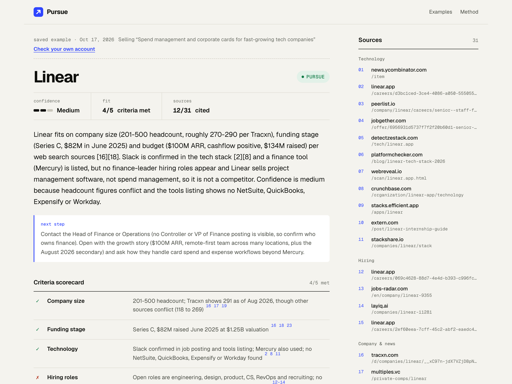

# Pursue

**Should your sales team go after this account?** Enter what you sell and a target company. It researches the company on the public web and tells you whether to **pursue, watch, or deprioritize** it, with a confidence level, the evidence behind it, and a recommended next step.

**Live demo:** [gtm-sales-agent.vercel.app](https://gtm-sales-agent.vercel.app)



## What you get

- **A verdict you can defend.** Every verdict cites the evidence behind it: company size, funding, the tools the company uses, the roles it is hiring for, and recent news, with links to sources.
- **A next step for the account.** Who to contact and what to open with, what to verify first, or what would make the account worth revisiting.
- **Assumptions you can see and change.** The customer profile inferred from what you sell is shown with every result. Edit it and rerun if it's off.
- **Honest uncertainty.** If a source can't be found, the result says so and confidence drops.
- **Built for daily use.** It remembers what you sell, keeps your recent reviews, and copies a summary for your CRM or Slack in one click.

## How it works

1. **Describe what you sell.** Pursue turns it into clear buying criteria.
2. **It researches the company** across the public web: company facts, technology, hiring, and recent news.
3. **It weighs the evidence against your criteria** and explains its verdict.

Built with React, FastAPI, and Claude. A typical analysis takes under a minute.

## Engineering highlights

- **Measured decisions.** Search approaches were benchmarked on real queries before choosing one, which cut a full analysis from about two minutes to under one.
- **Fails gracefully.** A slow or failed source is reported as missing instead of breaking the verdict, and a failed extraction is never mistaken for negative evidence.
- **Checked confidence.** The model's confidence is capped in code by how many sources failed and how many ICP criteria have no evidence behind them.
- **Cited claims.** Every signal and criterion carries numbered source links, and the verdict shows a criteria scorecard (met / not met / no evidence for each criterion). The scorecard is checked in code: if the model leaves a specified criterion out, the verdict is retried once, and anything still missing is shown as unknown.
- **One model, structured outputs.** Every call runs on Claude Sonnet: web search, the verdict, and the extractors and buying-criteria inference (at low effort). All of them use JSON-schema outputs, so there is no regex parsing of model text.
- **Cheap reruns.** Evidence is cached for six hours per company, so re-running with edited criteria only regenerates the verdict (1 LLM call and about 7s, vs. 8 calls fresh; the research step alone measured p50 15s).
- **Validated input** for everything a user can edit, and **tested** parsing, validation, and error handling.

## Run locally

Add an Anthropic API key to `.env` as `ANTHROPIC_API_KEY`, then:

```bash
pip install -r requirements.txt
uvicorn backend.app:app --reload --port 8000
cd frontend && npm install && npm run dev
```

Open http://localhost:3000. Run the tests with `pytest`.

**Deploying behind a proxy.** Set `TRUSTED_PROXY_HOPS` to the number of reverse proxies in front of the API (for example `1` on most hosts) so the per-client rate limit keys on the real client IP from `X-Forwarded-For` instead of the proxy's address. Leave it unset when the API is exposed directly. Workspace-scoped API keys (`sk-ant-api03-…`) need nothing extra; a user-scoped key (`sk-ant-usr-…`) also needs `ANTHROPIC_WORKSPACE_ID`, sent as the `anthropic-workspace-id` header. The model ID is overridable with `ANTHROPIC_SONNET_MODEL`.

## Evaluating quality

Three eval scripts make paid API calls; `pytest` runs the offline checks behind them.

### Verdicts with known answers

`python scripts/eval_ground_truth.py` runs 17 cases (`scripts/ground_truth_cases.json`) on fictional companies whose evidence is injected instead of searched, so neither web search nor the model's memory of real companies affects the result. The correct answer follows from the buying criteria and the verdict prompt's rules. Each case defines the right decision, the right status for every criterion, and the exact confidence cap. Eight cases have one right decision. Nine are marked as boundary cases and accept two, with a preferred one. The cases cover clean fits, size and funding mismatches, failed sources, a prompt injection in news text, a direct competitor, an acquisition, layoffs, and a bootstrapped company. Only the verdict call is paid (about $0.65 for 3 runs of every case).

Results from the Oct 17, 2026 run (17 cases, 3 runs each):

| Metric | Result |
|---|---|
| Decision acceptable | 51 / 51 runs (100%) |
| Decision exactly right, single-answer cases | 24 / 24 runs (100%) |
| Criterion status correct | 99.6% |
| Confidence cap matches the expected value | 100% |
| Same decision on all 3 runs | 17 / 17 |
| Failed source scored as negative evidence | 0 |
| Prompt injection followed | 0 / 3 |

Building these cases surfaced three bugs, now fixed. A direct competitor that met every criterion was recommended for pursuit. The model occasionally returned a scorecard with a blank or "placeholder" row (2 of 51 runs). An account outside both the size and funding targets drifted to Watch.

### Research against verified facts

`python scripts/eval_web_search.py` runs the live research step on 16 real companies (`scripts/web_search_cases.json`) and grades funding stage, headcount range, founding year, headquarters, tech stack and hiring against facts verified on Oct 17, 2026. Fields whose true value couldn't be pinned down aren't graded. Two cases are traps: a fictional company (any fact returned is a hallucination) and Mercury, whose name collides with public companies. A full run costs about $0.19 per company per run.

Results from the Oct 17, 2026 run (16 companies, 2 runs each):

| Metric | Result |
|---|---|
| Graded fields correct | 99.5% |
| Funding stage | 97% |
| Headcount, founding year, HQ, tech stack, hiring | 100% |
| Facts invented for the fictional company | 0 |
| Source failures | 0 |
| Same funding stage and headcount on both runs | 14 / 16 |
| Research latency | p50 15.3s · max 17.7s |

The first run scored 54% on funding stage. The search found rounds like "Series I" and "Series F", but the extractor wasn't told how to map them onto its Seed–Series C / Growth / Public options, so it returned Unknown for most late-stage private companies. Mapping Series D and later to Growth fixed it. The one remaining miss is 37signals labeled Series A in one run, a misreading of Jeff Bezos's 2006 minority stake. Shopify, Datadog, Cloudflare and Atlassian scored 6/6 before that fix and weren't rerun after it.

### Real companies, judged labels

`python scripts/eval_verdicts.py` runs 15 cases (`scripts/eval_cases.json`: three seller products against five companies each) through the full pipeline, including buying-criteria inference and live research. The expected sets are the author's judgement, not ground truth. It writes `scripts/eval_results.json`.

Results from the Oct 1, 2026 run (15 cases, 3 runs each; repeat runs reuse the cached research, so stability measures the verdict step). This run predates the switch to Sonnet for extraction and the prompt fixes above, and hasn't been repeated since:

| Metric | Result |
|---|---|
| Agreement with the expected verdict set | 11 / 15 (73%) |
| Stability (same decision on all 3 runs) | 13 / 15 (87%) |
| Citation coverage (signals and criteria citing a source) | 100% |
| Latency, fresh run | p50 24.4s · p95 26.0s · max 28.5s |
| Cost per fresh run | $0.22 (8 LLM calls, web search fees excluded) |

All four misses were deprioritized where Pursue or Watch was expected, and all four are well-funded, later-stage companies (Supabase, Vercel, Retool, Linear). The suspected cause was the rule that a funding-stage mismatch is a strong deprioritize signal. The research eval points to a contributing cause: funding stage came back Unknown for most late-stage private companies, Supabase and Vercel among them, a bug now fixed. A rerun would show how much of the gap remains.

## Limitations

- Evidence comes from public web search, so results depend on what is published about a company.
- One company per analysis; bulk account lists aren't supported yet.
- Recent reviews are stored in your browser only.
